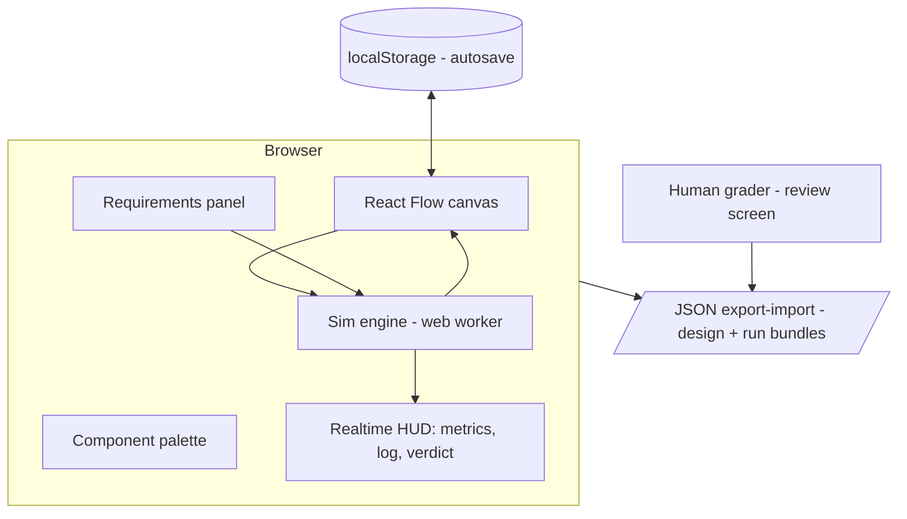

# 01 — Architecture

## Stack (decided)

| Layer | Choice | Why |
|---|---|---|
| Framework | Next.js 16 (App Router) + TypeScript | One codebase, one deployable, API routes included |
| Canvas | React Flow (`@xyflow/react`) | Typed node/edge graph → serializes to JSON → simulatable & gradable. Custom React nodes give full visual control |
| State | Zustand | React Flow's recommended store; simple, no boilerplate |
| Styling | Tailwind CSS | Fast iteration on custom nodes |
| Simulation | Pure TypeScript module + Web Worker | Deterministic, testable, runs client-side at 10 ticks/s with zero backend |
| Persistence | localStorage + JSON file export/import | No accounts, no server state; a design or run is a file you can share (decision 2026-07-12 — DB/auth dropped) |
| Grading | Human + rubric scorecard | Grader imports the exported run file: recorded action timeline + sim replay, scores per phase. AI grading (Claude API) deferred to far-future premium |
| Auth | None | Local-first single-user app; nothing to protect |
| Deploy | Vercel / any Node host | Stateless app — no DB to operate; decide specifics at M5 |

Key principle: **engine-style modularity** — every `src/lib/*` folder is a pure-TS engine with plain-data contracts, no framework imports, no sideways dependencies. The UI is a thin shell wiring engines together. Full rules, extension points, and enforcement: [[05-engines]].

## System diagram



Realtime = worker posts a `SimFrame` every tick; canvas nodes re-render utilization bars/colors, edges animate flow. No websockets needed for single-player; interviewer spectating (post-MVP) adds a broadcast channel.

## Product modes (M7)

One canvas and one simulation engine, three framings ([[docs/superpowers/specs/2026-11-05-product-modes-design|product modes design]]). Modes are a **shell** concern: engines (`src/lib/**`) never see a mode.

| Mode | What `/design/[id]` renders | Since |
|---|---|---|
| **Quick simulation** | Starter design (Client → App server → SQL database), big Run, simple HUD (served RPS, p95, error %), plain-language verdict, event log, replay. Scenarios behind "More scenarios" (Quick-only list), chaos behind "Break it" (only while running), next-challenge card, "Try a full practice interview". No phases, notes, requirements, canvas lock, review screen or action recording. | M7 |
| **Practice** | The full interview, unchanged from M4–M6: phase bar + timers + canvas lock, phase notes, requirements, scenario + chaos panel, action recording, review screen + self-graded scorecard. | M4 |
| **Interview** | Not built (M11). The landing card says "Coming soon"; a record with this mode opens in the Practice layout with a one-line notice. | M11 |

- **Mode is data.** `DesignRecord.mode: DesignMode` (shell type in `persistence/local.ts`). A missing or unknown value loads as `"practice"`, with no migration. A design's mode is fixed for life: in-place "Import JSON" keeps it, and a landing-page import creates a new design with the file's mode.
- **One route.** `DesignWorkspace` attaches the design, waits until it's attached, then picks the layout from a `Record<DesignMode, Component>` map (`QuickWorkspace`, `PracticeWorkspace`, `InterviewPreviewWorkspace`).
- **Quick data is plain data.** Starter graph: `components/quick/starter.ts`. Starter + challenge scenarios: `QUICK_SCENARIOS` in the scenarios engine, never mixed into `SCENARIO_PRESETS`. Challenges: `QUICK_CHALLENGES` (`scenarios/challenges.ts`). Solved state is per browser: `bp:challenges:solved` (`persistence/challenges.ts`).
- **Store lifecycle.** Entering Quick selects the starter scenario. Leaving it resets the sim and restores Practice's default preset (`leaveQuickMode`). Quick never records actions (`recordInterviewAction` returns early).
- **Moving between modes.** No conversion in v1. Quick's "Try a full practice interview" creates a new blank Practice design (same as the landing Practice card with no name), resets the phase clock, and opens it. The Quick design stays saved.

## Repo layout (`app/`)

```
app/
├── src/
│   ├── app/
│   │   ├── page.tsx            # landing: mode cards, saved designs, built-in stress tests
│   │   ├── design/[id]/page.tsx  # workspace: DesignWorkspace renders the layout for the design's mode
│   │   └── review/[runId]/page.tsx  # replay + action timeline + scorecard (loads imported run file)
│   ├── components/
│   │   ├── landing/
│   │   │   ├── LandingScreen.tsx      # mode cards + saved designs (mode badges) + import
│   │   │   ├── ModeCards.tsx          # Quick (one click) / Practice (create) / Interview (coming soon)
│   │   │   ├── ModeBadge.tsx
│   │   │   ├── new-design.ts          # pure record builders: newQuickDesign, newPracticeDesign, importAsNewDesign
│   │   │   ├── styles.ts              # shared landing class tokens
│   │   │   └── ScenarioCards.tsx
│   │   ├── layout/
│   │   │   ├── DesignWorkspace.tsx    # attach design, then pick the layout by mode
│   │   │   ├── PracticeWorkspace.tsx  # today's full interview layout (+ interview-mode notice)
│   │   │   └── SmallScreenNotice.tsx
│   │   ├── quick/
│   │   │   ├── QuickWorkspace.tsx     # Quick layout: canvas, big Run, simple HUD, right column
│   │   │   ├── QuickMenus.tsx         # "More scenarios" + "Break it"
│   │   │   ├── MenuButton.tsx         # dependency-free disclosure menu (also icon-only, right-aligned)
│   │   │   ├── quick-actions.ts       # switchQuickScenario / leaveQuickMode (store lifecycle)
│   │   │   ├── starter.ts             # starter DesignGraph + default name
│   │   │   ├── ChallengeCard.tsx      # next-challenge nudge + full list
│   │   │   ├── challenge-nudge.ts     # pure: what the card suggests after a run
│   │   │   └── TryPracticeLink.tsx    # Quick → new Practice design
│   │   ├── canvas/
│   │   │   ├── DesignCanvas.tsx       # React Flow wrapper
│   │   │   ├── nodes/ComponentNode.tsx  # generic node: icon, util bar, state color
│   │   │   ├── nodes/GroupNode.tsx      # region/AZ containers
│   │   │   └── edges/FlowEdge.tsx       # animated traffic edge
│   │   ├── palette/Palette.tsx        # drag source, driven by registry
│   │   ├── panels/NodeConfigPanel.tsx    # selection inspector (node / edge); hidden with nothing selected
│   │   ├── panels/DesignFileMenu.tsx     # "⋯" metrics-bar menu: Export / Import JSON
│   │   ├── panels/RequirementsPanel.tsx  # NFR inputs: RPS, p95, consistency, error budget
│   │   ├── panels/ScenarioPanel.tsx      # pick scenario, run/pause, chaos buttons
│   │   ├── panels/chaos-actions.ts       # chaos list shared by ScenarioPanel and "Break it"
│   │   ├── panels/EdgeInspector.tsx      # selected edge: timeouts, retries
│   │   ├── hud/MetricsBar.tsx            # p95, error %, served RPS cards
│   │   ├── hud/EventLog.tsx
│   │   └── hud/Verdict.tsx
│   ├── lib/
│   │   ├── registry/
│   │   │   ├── types.ts          # ComponentDef
│   │   │   └── components.ts     # THE data: postgres, redis, kafka, lb, app, cdn, s3...
│   │   ├── simulation/
│   │   │   ├── types.ts          # SimNode, SimFrame, RunResult
│   │   │   ├── engine.ts         # tick(state) => state — pure
│   │   │   ├── node-models.ts    # per-kind capacity/latency/queue math
│   │   │   ├── edge-state.ts     # per-edge timeouts/retries state (T-8.6: breaker)
│   │   │   ├── rules.ts          # ramp/spike/kill/flush/partition appliers
│   │   │   ├── verdict.ts        # NFR pass/fail evaluation
│   │   │   ├── rng.ts            # seeded PRNG (mulberry32)
│   │   │   ├── run.ts            # runSimulation: rules + frames + verdict → RunResult
│   │   │   ├── worker-host.ts    # worker protocol brain (pure, testable)
│   │   │   ├── worker.ts         # worker entry: binds host to self
│   │   │   └── client.ts         # createSimWorker: spawns the worker (browser)
│   │   ├── scenarios/
│   │   │   ├── types.ts          # Scenario schema
│   │   │   ├── challenges.ts      # QUICK_CHALLENGES: scenario id + goal + hint (ordered)
│   │   │   └── presets/           # shared: black-friday, celebrity-tweet, az-outage; Quick-only: starter, quick-*.json
│   │   ├── grading/
│   │   │   └── rubric.ts         # per-phase rubric with 1–5 anchors (requirements/API/HLD/deep-dive)
│   │   └── actions/
│   │       └── recorder.ts       # records ActionEvents (node added, config changed, note edited...)
│   ├── persistence/
│   │   ├── local.ts              # localStorage autosave + JSON export/import; DesignRecord.mode
│   │   └── challenges.ts         # Quick challenge solved state (bp:challenges:solved)
│   └── stores/
│       ├── design-store.ts       # zustand: graph, selection
│       ├── design-file-store.ts  # export/import of the attached design + import error
│       ├── scenario-store.ts     # zustand: selected preset + edited NFRs
│       └── sim-store.ts          # zustand: run state, frames, log
├── tests/
│   ├── engine.test.ts            # deterministic scenarios → exact expected frames
│   ├── node-models.test.ts
│   └── verdict.test.ts
├── e2e/
│   ├── smoke.spec.ts             # Playwright: landing → design → Run → verdict (production build)
│   ├── landing.spec.ts           # Quick card opens the starter in one click; landing import keeps the file's mode
│   ├── quick.spec.ts             # Quick design → simple workspace → Run → plain verdict
│   └── quick-to-practice.spec.ts # Quick → Run → Passed → "Try a full practice interview" → fresh Practice design
├── scripts/
│   └── sim.ts                     # headless CLI: graph + scenario → verdict (npm run sim)
└── examples/                      # demo inputs for the CLI (twitter.json, black-friday.json)
```

## Decisions

- 2026-07-12: React Flow over Excalidraw/tldraw — structured graph is required for simulation and grading.
- 2026-07-12: Simulation client-side, not server-side — free realtime, no infra; results stay local (export files). Revisit if anti-cheat matters.
- 2026-07-12: Next.js **16.2** (current stable), not 15 — spec predated the release; create-next-app ships 16 and bundles migration docs in `node_modules/next/dist/docs/` (see `app/AGENTS.md` warning).
- 2026-07-12: **DB and auth dropped** — local-first app, no server state. localStorage autosaves; designs/runs/scorecards export as JSON files the grader imports on the review screen. Postgres/Drizzle/docker-compose removed from `app/` (removal commit `5f02d71`, code recoverable from `5de2a01`). A DB may return post-MVP (hosting/accounts/AI grading) — all boundary types are JSON-serializable, so the migration stays mechanical; see [[02-data-model]] "If a database returns".
- 2026-07-12: Grading is human-first. The grader "watches" the candidate via the recorded action timeline + sim replay and fills a rubric scorecard. AI grading (Claude API) moved to far-future premium — removes API cost, prompt engineering, and trust questions from MVP.
- 2026-11-05 (M7): Product split into Quick / Practice / Interview modes (spec: product-modes design). Mode is shell data on DesignRecord; one route, layout chosen by mode; engines stay mode-unaware. Quick → Practice creates a new blank Practice design in place (router.push + phase-clock reset; sim and scenario reset by leaving the Quick layout). No conversion in v1.
