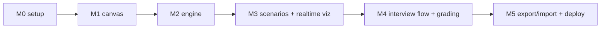

# 04 — Roadmap

Six milestones, strictly ordered. Each milestone ends with a working demo — never a half-built layer. M0–M3 is the MVP that proves the idea (canvas + live stress test); M4–M5 make it a product.

| # | Milestone | Demo at the end | Est. sessions |
|---|---|---|---|
| M0 | [[tasks/M0-project-setup\|Project setup]] | `npm run dev` shows empty shell; lint/test/typecheck green | 1–2 |
| M1 | [[tasks/M1-canvas-and-palette\|Canvas & palette]] | Drag components, connect, configure, save/load JSON locally | 3–4 |
| M2 | [[tasks/M2-simulation-engine\|Simulation engine]] | CLI/test run: graph + scenario in → frames + verdict out, all golden tests pass | 4–5 |
| M3 | [[tasks/M3-stress-scenarios\|Stress scenarios & realtime viz]] | Press Run: nodes color live, edges animate, log streams, verdict shows; chaos buttons work | 3–4 |
| M4 | [[tasks/M4-interview-flow\|Interview flow & human grading]] | Full interview: phases with timers, notes, action recording, run sim; grader reviews timeline + replay and fills scorecard | 3–4 |
| M5 | [[tasks/M5-persistence-and-deploy\|Export/import & deploy]] | Live URL: do interview, export run bundle, import it on the review screen, past designs survive reload (no accounts — local-first) | 2–3 |
| M6 | [[tasks/M6-post-mvp-features\|Post-MVP features]] | Auto-balancing load balancer | 1 |
| M7 | [[tasks/M7-quick-mode\|Quick mode]] | Landing → one click → starter design runs green; challenge nudge breaks it | 4–6 |
| M8 | [[tasks/M8-trustworthy-simulation\|Trustworthy simulation]] | Queue absorbs a burst; fan-out validates; retry storm + breaker | 5–7 |
| M9 | [[tasks/M9-components-and-cost\|More components + cost]] | Two-region chat system with WebSocket gateway and cost overlay | 5–7 |
| M10 | [[tasks/M10-practice-depth\|Practice depth]] | Solve a problem with a hidden event, self-review vs par, share by link | 3–4 |
| M11 | [[tasks/M11-live-interview-mode\|Live Interview mode]] | Interviewer + candidate in one live session | 5–7 |
| M13 | [[tasks/M13-practice-step-boards\|Practice step boards]] | Requirements lists, entity board with crow's-foot relations, API endpoint cards; jump between steps | 4–6 |

**Cut lines if time is short:** M4 timers (keep phases as plain sections). Never cut M2 tests — the engine is the product. (M5 auth/DB cut 2026-07-12 — local-first for now; a DB may return post-MVP if hosting/accounts become a goal, see [[02-data-model]] "If a database returns".)

Post-MVP plan (2026-11-05): M7–M11 above, ordered in [[tasks/backlog]], plus slot-anywhere [[tasks/MH-housekeeping|housekeeping]]. Product splits into three modes (Quick / Practice / Interview), see [[docs/superpowers/specs/2026-11-05-product-modes-design|product modes design]].

**Parked:** AI feedback/grading via Claude API (postponed 2026-11-05, too far away), leaderboards, custom scenario editor UI.

## Decisions

- 2026-11-05: Roadmap extended past MVP with M7–M11. Quick mode first (product priority), then simulation correctness, components + cost, practice depth, live interview mode. AI feedback parked.
